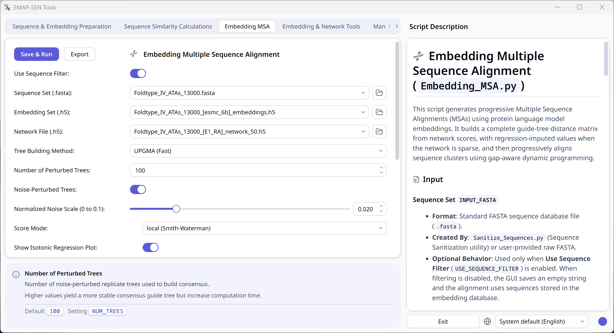
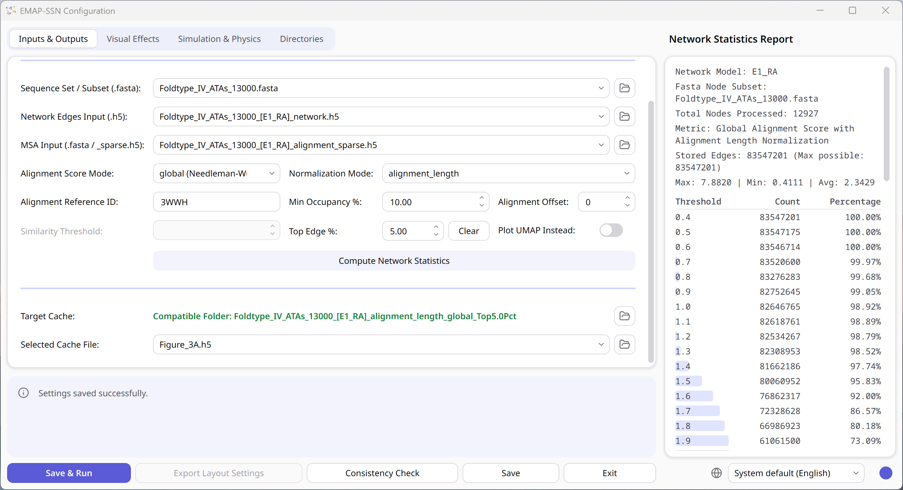
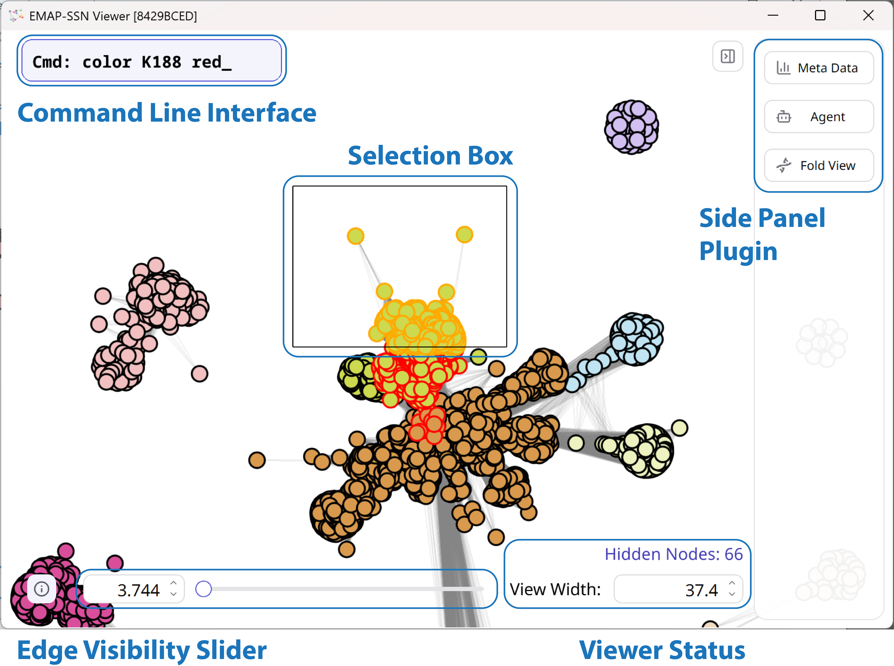

# EMAP-SSN

[](https://www.python.org/)
[](https://github.com/Xuebin-Feng/EMAP-SSN/releases/latest)
[-lightgrey.svg)](https://github.com/Xuebin-Feng/EMAP-SSN)
[](LICENSE)
[](https://doc.qt.io/qtforpython/)
[](https://vispy.org/)

**EMAP-SSN: Embedding- and Multiple-Alignment-integrated Protein Sequence
Similarity Network Platform** is an interactive, high-performance
graphical application for generating, visualizing, and analyzing traditional
and embedding-based Sequence Similarity Networks (SSNs). By integrating
Multiple Sequence Alignments (MSAs) directly into network exploration, the
platform bridges macroscopic sequence relationships with microscopic
residue-level conservation to provide a multi-scale view of protein sequence
space.
The latest release recorded in the changelog is **v0.4.0**.
This README describes the current source checkout, which may include changes
since that release. Because EMAP-SSN remains below version 1.0, command
interfaces and persisted formats may evolve between releases. See the
[changelog](CHANGELOG.md) for release history and [citation metadata](CITATION.cff)
for how to cite the software. When upgrading an existing checkout, read the
release's Upgrade Notes in the changelog first.

---
## ⚠️ Important Note

1. **Cross-Platform Support**: Host architecture, operating-system, and accelerator support is conditional. See [Compatibility](#-compatibility) before installation; Linux and Apple Silicon macOS support remains under active development.
2. **Recommended Hardware**: A compatible **NVIDIA GPU** is highly recommended for CUDA acceleration of embeddings and layout solvers. Selected AMD and Intel devices and Apple Silicon GPUs can use the backends listed in [Compatibility](#-compatibility); every accelerator must pass runtime validation.

---

## 📸 Overview

The application streamlines the entire SSN pipeline—from generation to interactive analysis—within a single unified workflow. It supports both traditional sequence similarity methods (e.g., BLAST) and modern embedding-based language model algorithms. For an end-to-end architectural guide, complete workflow description, and visual walkthrough of each GUI, see the [Quick Start Manual](docs/quickstart.html). Beyond dynamic visual formatting, the viewer provides an interactive command console with specialized commands tailored for deep analysis of the protein sequence space (see the [Viewer Command Reference](docs/list_of_commands.html) for detailed usage and examples).

---
## 🖥️ Graphical User Interface

### 🛠️ EMAP-SSN Tools GUI

All calculations related to SSN generation are centralized in the `EMAPSSN_Tools.py` GUI. The interface is organized into intuitive tabs, each representing a distinct stage of the pipeline. It includes interactive tooltips at the bottom for parameter input fields and a script description panel on the right highlighting the function of each processing script.



Each tool card also provides **Export** beside **Save & Run**. The
Directories tab controls the export location through **Setting Export
Directory**, which defaults to `Cache_Files/Exported_Settings/`. An exported file
contains the current settings for one tool and only the global directories
used by that tool. For example:

```json
{
  "DIRECTORIES": {
    "FASTA_DIR": "Input_Files/Sequence_Sets"
  },
  "Sanitize_Sequences.py": {
    "INPUT_FASTA": "example.fasta",
    "OVER_WRITE": false
  }
}
```

Run any exported configuration as the sole positional argument to its tool:

```powershell
# Windows
.\.venv\Scripts\python.exe src\tools\Sanitize_Sequences.py Cache_Files\Exported_Settings\example.json
```

```bash
# Linux or macOS
./.venv/bin/python src/tools/Sanitize_Sequences.py Cache_Files/Exported_Settings/example.json
```

The settings-file argument is resolved from the terminal's current working
directory. Directory values inside the JSON retain the GUI representation:
absolute paths remain absolute, while relative paths are resolved from the
project root. Omitting the argument preserves the GUI-compatible behavior of
reading `tools_settings.json` from the project root. Model acknowledgement remains a
separate command, for example
`python src/tools/Generate_Embeddings.py --accept-model-license MODEL_ID`.

### 🔌 Local STDIO MCP server

`src/EMAPSSN_MCP_Server.py` exposes 14 pipeline programs, layout-cache generation,
Viewer inspection, command execution, and session management to local MCP clients.
It registers exactly three workflow tools:

| MCP tool | Purpose |
| --- | --- |
| `emapssn_pipeline` | Discover tools, export and validate settings, inspect files and compute capabilities, run pipeline/layout jobs, and monitor or cancel work. |
| `emapssn_viewer_data` | Discover sessions, inspect immutable snapshots and residue distributions, read command results and logs, and capture the Viewer canvas. |
| `emapssn_viewer_control` | Export and validate Viewer settings, launch or connect to sessions, execute Viewer commands, disconnect, or close a Viewer. |

Each tool accepts `action` and an `arguments` object. Call `help` to list actions,
or `describe` to inspect one action's strict argument schema. For example, pass
this JSON to `emapssn_pipeline`:

```json
{"action": "describe", "arguments": {"action": "start_job"}}
```

Pipeline IDs are values inside `arguments`, not additional MCP tool names.
Legacy standalone MCP tool names are no longer registered; restart the server
and refresh the client's tool catalog after updating.

The server uses STDIO only: the client starts one server process and communicates through its standard input
and output. Before configuring a client, launch the Viewer or Tools through its
managed launcher so `.venv` is created or updated with the pinned MCP SDK.

Use absolute paths in client configuration. On Windows, replace `<PROJECT>`
below with the absolute repository path:

```powershell
# Codex
codex mcp add emapssn -- "<PROJECT>\.venv\Scripts\python.exe" "<PROJECT>\src\EMAPSSN_MCP_Server.py"

# Claude Code (user scope)
claude mcp add --transport stdio --scope user emapssn -- "<PROJECT>\.venv\Scripts\python.exe" "<PROJECT>\src\EMAPSSN_MCP_Server.py"
```

For VS Code, add this to the appropriate `mcp.json` file:

```json
{
  "servers": {
    "emapssn": {
      "type": "stdio",
      "command": "<PROJECT>\\.venv\\Scripts\\python.exe",
      "args": ["<PROJECT>\\src\\EMAPSSN_MCP_Server.py"]
    }
  }
}
```

Antigravity and clients using the common `mcpServers` form, including many
open-source harnesses, can use:

```json
{
  "mcpServers": {
    "emapssn": {
      "command": "<PROJECT>\\.venv\\Scripts\\python.exe",
      "args": ["<PROJECT>\\src\\EMAPSSN_MCP_Server.py"]
    }
  }
}
```

On Linux or macOS, use `<PROJECT>/.venv/bin/python` and forward-slash paths.
No environment activation or wrapper script is required. A harness with a
different configuration schema needs only the same executable and server-file
arguments over its local STDIO transport.

Pipeline action `start_job` accepts parameters with optional
directory overrides, an exported JSON document, or a path to that document.
Use pipeline action `get_compute_capabilities` for metadata-only discovery of runtime
devices and memory, and `inspect_file` for read-only structural inspection
of an explicitly selected file. Device discovery does not benchmark a workload
or establish that it will fit in memory. See [MCP settings and examples](docs/mcp_settings.md)
for the strict settings contracts and GUI export compatibility. Each client connection owns one
FIFO with one running and at most 16 pending jobs. Closing or restarting that
client terminates its running job and cancels its queued jobs; different MCP
clients do not share a queue and can start conflicting calculations. Pipeline
jobs may create or overwrite files according to their settings, and cancelling
a job does not roll back files already written.

Pipeline action `start_benchmark` queues the [benchmark](#benchmark) like any other
job; its `result` names the report and gives each stage's time.

Job responses report captured stdout/stderr, the immutable settings snapshot,
and the configured result directories. They do not guess the exact scientific
files produced by a program. MCP-owned logs and snapshots are temporary and
are removed on normal server shutdown; an abrupt crash can leave a private
`sequence_similarity_network_viewer/mcp_jobs/server-*` directory below the
operating system's temporary directory, which is safe to remove when no MCP
server is running.

Viewer-data action `list_sessions` discovers running Viewers through authenticated
local endpoints. Viewer-control action `connect_session` selects one;
`disconnect_session` leaves it running, while `close_session` explicitly stops it.
For a new session, use viewer-control `export_settings` to inherit saved preferences,
review the complete JSON, then call `validate_settings` and `start_session`.
Use `get_settings_schema` to inspect the accepted fields. Exporting writes a settings
file; validation and launch consume that explicit document without merging personal
settings again. A visible Viewer uses `mode: "normal"`; `mode: "headless"` runs
without a desktop window but still uses Qt/VisPy.
See [Viewer session settings](docs/mcp_settings.md#viewer-sessions), including the
Windows host restriction on independent subprocesses.

For analysis, capture a snapshot with viewer-data `get_summary`, then reuse its
`snapshot_id` with `describe_fields`, `create_subset`, `summarize_subset`, and
`query_nodes`. Alignment and visual data are opt-in through `include_alignment`
and `include_visual`. Use `get_residue_distribution` for residue counts and
cross-tabs from an alignment snapshot. Snapshots remain frozen after Viewer edits;
capture a new one to inspect the changed state, and follow returned cursors for
paged results.

Viewer-control `execute_commands` uses the same command portal as the web agent.
Supply a unique `submission_id` and reuse it if retrying that submission. Follow
viewer-data `get_command_request` until completion; `read_command_output` provides
printed diagnostics and `capture_view` returns the current canvas as PNG. Batches
stop on failure, and command submission alone does not mean background work has
finished. The server supplies an [agent workflow guide](src/mcp_server/Agent_Instructions.md)
during MCP initialization.

### ⚙️ EMAP-SSN Configuration GUI

The configuration GUI in `EMAPSSN_Config.py` simplifies input file selection and parameter tuning for SSN generation. The **Simulation & Physics** tab configures the SSN force-directed physics layout solver; UMAP and PaCMAP remain available as optional non-physics layout methods on the Inputs & Outputs tab.Each tab has a **Saved Config** selector: `(custom)` values are kept together in the project-root `viewer_settings.json`, while named per-tab JSON profiles are stored below the directory selected on the Directories tab. Its default expression is `$cache_file$/Saved_Config`, which resolves to `Cache_Files/Saved_Config/` with the default Cache File Directory. Selecting `(default)`, offered on every tab except Inputs & Outputs, loads read-only built-in values, and `(new)` creates a named profile from the settings currently shown. Directory values may begin with `$input_file$`, `$cache_file$`, `$analysis_result$`, or `$embedding$` to resolve beneath the corresponding configurable base directory; ordinary relative and absolute paths retain their existing behavior.

The GUI also features a **Compute Network Statistics** utility that analyzes network density and outputs a report in the right panel to guide selection of an optimal similarity cutoff. The **Consistency Check** utility compares the similarity network against the Multiple Sequence Alignment (MSA) to ensure sequence headers and indexes match across all files.



### 🔍 EMAP-SSN Viewer GUI

The main visualization window, `EMAPSSN_Viewer.py`, provides a 2D network canvas
with mouse and keyboard controls for panning, zooming, selection, and formatting.
Its in-line command console (HUD) runs analytical operations, highlights residues,
selects clusters, and exports figures. The `meta`, `esmfold`, and `agent` commands
open session-specific utilities in the system browser: a metadata table, a Mol*
structure viewer, and a conversational agent. The Tools documentation panel uses
embedded QtWebEngine.

Dimensionality follows from the viewer: the desktop Configuration and Viewer
always use 2D layouts. Headless and MCP layout jobs also accept
`LAYOUT_DIMENSIONS` (`2` or `3`); 3D caches use a separate cache folder with the
`_3D` suffix and are read by the optional VR viewer (`opt_vr` submodule).



### 🌐 Language

The windows can show their text in another language. The language dropdown (after a globe icon) at the
bottom right of the Configuration and Tools windows, and of the optional VR
viewer's Configuration window, offers
**System default** (the operating system's display language when EMAP-SSN has
it, English otherwise), **English**, and each bundled language, named in itself.
The first is Simplified Chinese (**简体中文**); its translations are machine-assisted
drafts that a native speaker has yet to review, and corrections are welcome (see
the translations guide below).

A circle after the dropdown sets the window's theme colour. The Configuration,
VR Configuration and Tools windows each take one of Purple (the default), Blue,
Teal, Green, Orange, Red, Pink or Black, and keep it in `app_settings.json`. The
Viewer takes the colour Configuration has when it starts.

The choice is saved in `app_settings.json` in the project folder and applies to
every window. The window it is chosen in redraws in the new language at once
and keeps everything entered; another Configuration or Tools window that is
open does the same the next time it is clicked into. The Viewer, its browser
pages and any dialog use it the next time they open. Number formats keep following the system's
regional settings.

The chosen language covers:

- the Configuration, Tools and VR Configuration windows, with their tips,
  messages and the Tools help pages;
- the Viewer's window, sidebar and dialogs, the text on its canvas (the HUD and
  the console line), and the Agent, metadata and Fold View pages it opens in the
  browser;
- the benchmark's text report.

These stay English in every language: the commands typed in the Viewer's
console, terminal output and logs, MCP replies, settings files, the benchmark's
`.json` results, and Mol*'s own panels, which the Fold View page shows only in
its Advanced view.

Simplified Chinese brings a font of its own, Noto Sans SC cut down to the GB2312
character set (4.37 MiB). The windows, the Viewer's canvas and the browser pages
use it only while that language shows, so Chinese draws correctly on a system
without a Chinese font.

Each language is one folder in `src/resources/languages/`, named by its code
(`zh_CN/`): its catalog, an optional `language.json` with its name, font and
punctuation, its translated help pages and its translated documentation pages.
Adding a language means adding its folder. To review a translation, add a language or mark new text for
translation, see the [translations guide](src/resources/languages/README.md).

The Quick Start manual and the Viewer command reference also exist in Simplified
Chinese (`src/resources/languages/zh_CN/docs/`). Each page has a language
dropdown that opens the other language's page at the same place, and
`src/resources/languages/Docs_Translation.py` tells which sections of a
translated page to update when its English page changes (see the translations
guide).

---
## 🧬 System Workflow

Start with a protein FASTA file and choose a traditional BLAST or embedding-based
network. The desktop workflow is:

1. **Prepare sequences.** Run `Sanitize_Sequences.py` from Tools to standardize the
   FASTA used by downstream calculations.
2. **Build a network.** Run `Align_Substitution_Matrix.py` for BLASTP, or generate
   embeddings with `Generate_Embeddings.py` and score pairs with
   `Align_Similarity_Matrix.py`. `Parse_BLAST_Output.py` imports external BLAST or
   DIAMOND tabular results using a matching FASTA manifest; run DIAMOND all-vs-all
   with `-k 0`, since it otherwise keeps only 25 hits per query. The BLAST
   calculation requires separate `blastp` and `makeblastdb` executables; the
   importer reads saved results without running BLAST or DIAMOND.
3. **Add an alignment when needed.** Generate an embedding-guided MSA with
   `Embedding_MSA.py`, or select an existing compatible full or sparse alignment.
   An MSA is optional for network viewing and required for residue-level analysis.
4. **Configure and cache the layout.** Select the matching node FASTA and network
   HDF5 in Configuration, and select an existing compatible cache or
   **(New Layout Cache)**. For a new cache, **Save & Run**
   calculates the layout before opening the Viewer. Reopening a compatible cache
   reuses its coordinates and verified generation settings.
5. **Explore and export.** Use the Viewer console to select, color, cluster,
   inspect residues, and export figures or sequence subsets.

The default layout uses a force-directed physics solver. **Plot Manifold Instead**
(`UMAP_MODE`) offers a manifold layout based on network scores, by the **Layout
Method** `UMAP` (the default) or `PaCMAP`. UMAP uses the `umap-learn` dependency
already included in the managed installation. `UMAP_NEIGHBORS` counts up to $k$
other nodes per sequence; the implementation adds a separate self-neighbor slot.
Missing connections remain missing rather than becoming zero-distance matches.
PaCMAP (Wang, Huang, Rudin and Shaposhnik, *J. Mach. Learn. Res.* 22(201), 2021)
is the project's own Numba port of the published optimizer, with no extra
dependency: each node's `PACMAP_NEIGHBORS` strongest edges (2 to 50, default 10)
are its near pairs and the edges kept and drawn, and it gets half as many mid-near
partners and twice as many further partners. A mid-near partner is the second
best of six random nodes by the network's stored score, looked up in one extra
pass over the stored pairs; that is what places clusters in a meaningful order
relative to each other (with random partners PaCMAP is no more global than
UMAP). A PaCMAP layout takes seconds, uses only CPU threads, has no minimum
distance, and repeats exactly for a given `LAYOUT_SEED` on any number of threads.
UMAP and PaCMAP use their neighbor topology instead of the physics layout's
similarity and top-edge filters.


See the [Quick Start Manual](docs/quickstart.html#workflow) for a visual walkthrough
and the [Viewer Command Reference](docs/list_of_commands.html) for command syntax.

---

## 🚀 Key Features

*   **Embedding-Based Dynamic Programming Alignment**: Score residue pairs using protein-language-model embeddings for pairwise alignment, network construction, and guide-tree multiple alignment.
*   **Interactive Visualization**: PySide6 and VisPy provide a 2D canvas for panning, zooming, selecting, and formatting nodes and edges. Performance depends on the dataset and rendering hardware.
*   **Integrated Command Console (HUD)**: Execute analytical commands (such as `zoom`, `select`, `color`, `cluster`, `subcluster`, and `logo`) directly inside the viewer viewport for instant formatting and analysis.
*   **Integrated Multiple Sequence Alignments (MSA)**: Bridge macroscopic network topology with residue-level conservation. Map conservation scores directly onto nodes and extract consensus sequence details interactively.
*   **Comprehensive Utilities Suite**: Centralized GUI in `EMAPSSN_Tools.py` supporting sequence sanitization, embedding generation (ESM, ProtBERT, ProstT5, Ankh), network edge filtering, guide-tree MSA generation, and sequence extraction/injection.
*   **Cross-Platform Hardware Acceleration**: Automatic eligibility checks and runtime validation for supported NVIDIA CUDA, AMD ROCm, Intel XPU, and Apple MPS configurations, with safe fallback to CPU.
*   **Scriptable Workflows**: Export tool and layout JSON for batch execution, or use the local MCP server for pipeline jobs, Viewer commands, and bounded scientific data inspection.

---

## ✅ Compatibility

*Compatibility snapshot: October 2026.* Compatibility is the intersection of
the application detector, the pinned Python packages, the operating system,
and the installed GPU driver. A device can be eligible for an installation
attempt without being guaranteed to work; the installer records it as
validated only after a tensor calculation succeeds on that device.

The status terms used below are:

- **Tested:** the application has been run on that operating-system family.
- **Supported:** the current installer and pinned upstream binary matrix cover
  the configuration.
- **Provisional:** the detector can attempt it, but the configuration has not
  been project-tested or is outside a fully validated upstream combination.
- **Unsupported:** the current managed Python 3.13 dependency set cannot be
  installed or the application deliberately excludes the configuration.

### Operating systems and processor architectures

| Platform | Status | Requirements and limits |
| --- | --- | --- |
| Windows x64 | Supported | CPU use requires Windows 10 version 1809 or newer. NVIDIA's current CUDA drivers support Windows 10 22H2 and Windows 11; EMAP-SSN does not check the build for CUDA. Intel XPU requires Windows 11. Native AMD ROCm requires Windows 11 25H2 build 26200+, the only Windows build covered by the ROCm 7.14 profile. Windows 11 is recommended. |
| Windows x86 (32-bit) | Unsupported | The pinned binary dependencies do not provide Win32 wheels. |
| Windows ARM64 | Unsupported | Python 3.13, `uv`, and the PyTorch 2.12.0 CPU wheel exist for Windows ARM64, but other pinned packages have no Windows ARM64 wheel for Python 3.13: biopython 1.88 publishes none, numba 0.67.0 publishes one only for Python 3.14, and the PyTorch package index has none for MarkupSafe, which PyTorch requires. The CUDA, XPU, and ROCm builds are x64-only. Running the x64 environment under Windows emulation is not project-supported. |
| Linux x86_64 | Tested on Ubuntu and Debian | Exact tested release numbers were not recorded. The pinned Qt wheel requires glibc 2.34 or newer; Ubuntu 22.04+ and Debian 12+ satisfy that baseline. The installer automates GUI system dependencies only on Debian-family systems. |
| Other x86_64 Linux distributions | Provisional | Modern glibc-based distributions may work after their Qt/XCB/QtWebEngine packages are installed manually. Fedora, RHEL, SUSE, Arch, and other distributions have not been project-tested. Accelerator support remains subject to the narrower vendor tables below. |
| Linux ARM64 and other Linux architectures | Unsupported | Some individual upstream packages publish ARM wheels, but the complete pinned application environment has not been resolved or project-tested on these architectures. |
| macOS ARM64 | Supported | Apple Silicon only, macOS 14 or newer, using MPS or CPU. |
| macOS x86_64 | Unsupported | PyTorch 2.12.0 used by this project does not provide the required Intel macOS runtime. |

The operating-system baseline follows the pinned [Qt 6.11 platform
matrix](https://doc.qt.io/qt-6.11/supported-platforms.html), the [official PyTorch
wheel index](https://download.pytorch.org/whl/cpu/torch/), and the platform
requirements linked below. "Tested" refers to this application, whereas a
vendor listing alone does not constitute live application testing.

Before it installs any Python packages, setup checks these floors: x64
Windows 10 version 1809 or newer, Apple Silicon with macOS 14 or newer, or
x86_64 Linux with glibc 2.34 or newer. On any other system it stops and names
the requirement the system misses, instead of failing partway through the
installation. Setting `SSN_ALLOW_UNSUPPORTED_HOST=1` skips the check for
experiments; such systems remain unsupported.

### Accelerator support by platform

| Accelerator | Windows x64 | Linux x86_64 | macOS ARM64 |
| --- | --- | --- | --- |
| CPU | Supported on Windows 10 version 1809+ and Windows 11 | Supported on the tested Ubuntu/Debian families; other distributions are provisional | Supported on macOS 14+ |
| NVIDIA CUDA | CUDA 13.2 or CUDA 12.6; NVIDIA's current drivers support Windows 10 22H2+ and Windows 11 | CUDA 13.2 or CUDA 12.6; distribution and driver must support the selected runtime | Not supported |
| AMD ROCm | Windows 11 25H2 build 26200+ only: ROCm 7.14 | Ubuntu and distributions built on it; Instinct MI300/MI350 also on the RHEL, Rocky Linux, Oracle Linux, Debian and SLES releases AMD lists: ROCm 7.14 | Not supported |
| Intel XPU | Windows 11 only, for the Intel GPUs below | Supported only for the device/OS combinations below | Not supported |
| Apple MPS | Not applicable | Not applicable | Supported on Apple Silicon with macOS 14+ |

#### NVIDIA CUDA

| Installer profile | Eligibility | Upstream binary coverage |
| --- | --- | --- |
| CUDA 13.2 | Every selected NVIDIA GPU must report compute capability 7.5 or newer and every driver must be version 580 or newer. | PyTorch 2.12 classifies CUDA 13.2 as experimental and publishes binaries for its listed Turing-and-newer architectures. Unlisted capability values remain provisional until runtime validation succeeds. |
| CUDA 12.6 | Used when the CUDA 13.2 conditions are not met. The effective PyTorch binary floor is compute capability 5.0. | Covers the listed Maxwell, Pascal, Volta, Turing, Ampere, Ada, and Hopper capability generations. Setup leaves a GPU below capability 5.0 out, with a message, and uses the CPU without downloading a CUDA build. |

A GPU newer than Hopper (compute capability above 9.0, such as Blackwell) runs
only on the CUDA 13.2 build. With an NVIDIA driver older than 580, setup leaves
that GPU out, prints a warning to update the driver, and uses the CPU until then.
One CUDA build serves every NVIDIA GPU in the computer, so beside a GPU older than
Turing (compute capability below 7.5) setup installs CUDA 12.6 for the older GPU
and leaves the newer one out with a warning.
Whenever a GPU build fails to install or validate, setup falls back the same way
and prints which build failed, the error, and how to retry with
`--refresh-backend`.

CUDA 12.x minor compatibility requires at least NVIDIA driver 525.60.13 on
Linux or 528.33 on Windows. With an older driver, setup leaves the GPU out and
prints a warning to update the driver; a current vendor driver is recommended.
See the
[PyTorch 2.12 support matrix](https://github.com/pytorch/pytorch/blob/main/RELEASE.md),
[current NVIDIA compute-capability table](https://developer.nvidia.com/cuda/gpus),
[legacy capability table](https://developer.nvidia.com/cuda/gpus/legacy), and
[CUDA 12.6 release notes](https://docs.nvidia.com/cuda/archive/12.6.0/cuda-toolkit-release-notes/index.html).

#### AMD ROCm

The application uses a pinned model-to-GFX snapshot and does not guess support
for newly released hardware. The following are application eligibility targets,
not a promise that every product with the same architecture will pass its
driver and tensor validation:

A single ROCm profile now covers both operating systems. Windows and Linux
install the same PyTorch 2.12.0 build from AMD's multi-architecture channel,
selected per GFX target:

| Platform/profile | Eligible GFX targets | Additional requirements |
| --- | --- | --- |
| Windows ROCm 7.14 / PyTorch 2.12.0 | `gfx1030`, `gfx1100`, `gfx1101`, `gfx1102`, `gfx1103`, `gfx1150`, `gfx1151`, `gfx1152`, `gfx1153`, `gfx1200`, `gfx1201` | Windows 11 25H2 build 26200+ and a supported AMD driver. |
| Linux ROCm 7.14 / PyTorch 2.12.0 | The Windows set, plus every other target the channel ships a PyTorch 2.12.0 device package for: `gfx908`, `gfx90a`, `gfx942`, `gfx950` (Instinct), `gfx1010`–`gfx1012` (RDNA1), and `gfx1031`–`gfx1036`. | Ubuntu 22.04, 24.04, 25.10, or 26.04, or a distribution built on one of them (Linux Mint, Pop!_OS and others, recognized by `ID_LIKE=ubuntu` and their `UBUNTU_CODENAME`); readable and writable `/dev/kfd`; and a target the kernel's ROCm driver reports for the GPU in `/sys/class/kfd`, or else one reported by `rocm_agent_enumerator` or `rocminfo`. A card matched only by name, with neither, is only provisionally eligible. AMD's ROCm 7.14.1 matrix lists Ubuntu 22.04, 24.04 and 26.04, and for Ryzen processors' graphics only 24.04 and 26.04; Ubuntu 25.10 and Ubuntu-based distributions are accepted but not listed by AMD. Instinct `gfx942` (MI300A, MI300X, MI325X) and `gfx950` (MI350X, MI355X) are also accepted on the other releases AMD lists for any model of the target: RHEL 8.10, 9.4, 9.6, 9.8, 10.0 and 10.2; Oracle Linux 9 and 10 (and 8 for `gfx942`); Rocky Linux 9 (`gfx942` only); Debian 12 and 13; SLES 15.7 and 16.0. These are upstream-listed but project-untested; the installer's tensor validation decides. |

The two platforms differ because of how the GFX target is identified. Windows
exposes no way to query it, so the target is inferred from the product name
against a pinned snapshot, and only models in that snapshot are eligible. On
Linux the kernel's ROCm driver (amdgpu's KFD) reports each GPU's target in
`/sys/class/kfd`, by PCI address and without any ROCm software installed, and
that target is used whatever the product name suggests, provided the ROCm
channel publishes a PyTorch 2.12.0 device package for it. That covers AMD
Instinct parts and RDNA1/RDNA2 consumer cards the snapshot never named, and
gives each GPU in a computer with several its own target; a GPU the KFD lists
no node for cannot run ROCm. Where the kernel reports no targets, a target
reported by `rocm_agent_enumerator` or `rocminfo` is used instead when the
product name is not in the snapshot, but only when exactly one supported
target is reported: with several, none can be attributed to a single adapter,
and name matching remains the only source.

Earlier releases offered four ROCm profiles (Windows 7.14 and 7.2.1, Linux 7.2
and 6.4). ROCm 7.14 covers every GFX target the retired profiles did, so no
previously eligible GPU loses support. The retired Windows ROCm 7.2.1 profile
was limited by AMD to Python 3.12, which is why it could not move to the
managed Python 3.13 environment.

One consequence is worth stating plainly: **Windows ROCm now requires
Windows 11 25H2 build 26200 or newer.** The retired 7.2.1 profile was the only
one AMD published for earlier Windows 11 builds. A Windows 11 machine below
25H2 is no longer eligible for ROCm and uses the next available accelerator or
CPU.

The installer does not install the Linux kernel driver or system ROCm stack.
Consult the [ROCm 7.14.1 compatibility matrix](https://rocm.docs.amd.com/en/docs-7.14.1/compatibility/compatibility-matrix.html)
for the matching operating system, driver, and hardware requirements.

SSN physics layouts on a GPU use two small kernels that EMAP-SSN compiles when a
layout first needs them, with the compiler that ships with PyTorch: NVRTC on
NVIDIA, hiprtc on ROCm. **The ROCm build of these kernels has not been tested on
AMD hardware.** Before first use, every process checks the kernels against a
double-precision evaluation of the same physics on a small test problem; if they
fail to compile or disagree, layouts automatically use the slower PyTorch
implementation and the layout log says why. Setting `SSN_LAYOUT_GPU_KERNELS=0`
forces that fallback on any GPU.

#### Intel XPU

| Device family | PCI device IDs (`8086:`) | Supported operating-system combinations |
| --- | --- | --- |
| Arc A-series (Alchemist), including Arc Pro | 5690–5697, 56A0–56A6, 56B0–56B3, 56BA–56BF | Windows 11; Ubuntu 24.04, 25.10, or 26.04 |
| Arc B-series (Battlemage), including Arc Pro | E202, E209, E20B–E20D, E210–E212, E215, E216, E220–E223 | Windows 11; Ubuntu 24.04, 25.10, or 26.04 |
| Core Ultra Series 1 H processors (Meteor Lake-H) | 7D55, 7DD5 | Windows 11; Ubuntu 24.04, 25.10, or 26.04 |
| Core Ultra Series 1 U processors (Meteor Lake-U) | 7D40, 7D45 | Windows 11 only |
| Core Ultra Series 2 H processors (Arrow Lake-H) | 7D51, 7DD1 | Windows 11; Ubuntu 24.04, 25.10, or 26.04 |
| Core Ultra Series 2 V processors (Lunar Lake) | 6420, 64A0, 64B0 | Windows 11; Ubuntu 24.04, 25.10, or 26.04 |
| Core Ultra Series 3 (Panther Lake) | B080–B087, B08F, B090, B0A0, B0B0 | Windows 11; Ubuntu 25.10 or 26.04 |
| Data Center GPU Max 1100, 1100C, 1350, 1450 and 1550 | 0B69, 0B6E, 0BD5–0BDB | Ubuntu 22.04, RHEL 9.2, or SLES 15. The non-Ubuntu combinations are upstream-listed but project-untested. |
| Any other Intel graphics, such as Core Ultra Series 2 U and desktop processors (Arrow Lake-U and -S), Wildcat Lake, Data Center GPU Flex, the Max 1550VG, and Iris Xe, UHD and HD graphics | — | Not eligible for XPU; another accelerator or CPU is used. |

Ubuntu 26.04 is accepted but project-untested. An Intel GPU is identified by
its PCI device ID (`lspci -nn` on Linux, the adapter's device instance path on
Windows), not by its name, which follows branding: the same Meteor Lake-H GPU
is "Intel Arc Graphics" or "Intel Graphics" depending on the memory fitted, and
older PCI ID lists name many of these GPUs only "Intel Graphics" or not at all.
The table follows the kernels the pinned PyTorch 2.12.0 XPU builds carry:
compiled ahead of time for these GPUs, per operating system (Meteor Lake-U on
Windows only, Data Center GPU Max on Linux only). The GPUs in the last row could
only compile kernels when first used, and PyTorch lists none of them; the older
Xe-LP graphics (Iris Xe, UHD) are not PyTorch XPU targets at all. Only when no PCI device ID is available is an Arc, Core Ultra Arc or Data
Center GPU Max name accepted instead.

Integrated graphics are eligible for the XPU PyTorch installation. After runtime
tensor validation, automatic workload benchmarks compare available devices with
CPU; integrated graphics are not excluded based on assumed performance.

The Intel driver must already be installed; on Windows, a GPU shown as
Microsoft Basic Display Adapter has none and is not eligible. See the [PyTorch
Intel XPU matrix](https://docs.pytorch.org/docs/2.12/notes/get_start_xpu.html)
for the validated hardware and operating-system combinations.

#### Apple MPS

MPS is selected only when both macOS and the `arm64` architecture are detected.
All Apple Silicon generations use the same eligibility rule and must pass the
runtime tensor check; otherwise the environment falls back to CPU. See Apple's
[PyTorch MPS requirements](https://developer.apple.com/metal/pytorch/).

### Backend selection and limitations

- Compatible discrete GPUs are preferred over integrated GPUs; NVIDIA, AMD,
  and Intel are ordered within the same device class.
- One backend-specific PyTorch build is installed per `.venv`. GPUs from
  different vendors cannot be used simultaneously in the same environment.
- Multiple validated NVIDIA or Intel devices can remain available to the
  application's automatic benchmark. For mixed AMD integrated/discrete
  systems, only the preferred GFX target is installed.
- A failed installation or tensor validation advances to the next eligible
  backend and ultimately to CPU.
- The selected backend and validation results are stored in
  `.venv/ssn_backend.json`. Requirements, pinned ESM and Transformers versions, compatibility
  rules, or a change to the required PyTorch profile invalidate the relevant
  saved state. Physical GPU addresses, device enumeration order, and driver
  updates that remain within the same CUDA compatibility profile do not force
  PyTorch to be reinstalled; the existing build is validated and reused.
- The check that every launch runs ends with a test that imports the ESM and
  Transformers packages, which can take about 20 seconds when the files are not
  cached (antivirus scans each one it opens). A pass is recorded in
  `.venv/ssn_esm_stack.json` with a fingerprint of the installed packages and the
  interpreter, and the test is skipped while that fingerprint is unchanged.
  Installing, upgrading or removing a package, or deleting that file, runs it
  again.
- The packages the installer names are pinned to the versions this release
  was tested with: the base requirements in `src/requirements.txt`, the ESM
  runtime dependencies in `src/esm_runtime_requirements.txt`, PyTorch,
  Transformers, and ESM. The packages those depend on are not locked and
  resolve to current compatible versions. The first launch after an update
  installs any changed pins and reuses the installed PyTorch build once it
  validates.
- A shared HPC `.venv` retains its installed accelerator build when inspected
  from a CPU-only login node. CPU work remains available there, and accelerator
  tensor validation resumes on a compute node. Moving to a genuinely different
  backend profile, such as CUDA 12.6 to CUDA 13.2 or a different ROCm GFX
  target, still selects the required build.
- Run
  `python src/Install_Dependencies.py --refresh-backend` inside the managed
  environment to deliberately reinstall from the currently visible candidate
  ladder. On a CPU-only node, this explicit override selects the CPU build.

---

## ⚙️ Installation Steps

1. **Clone the repository:**
   Download the repository or clone it into a local project directory:

   ```bash
   git clone https://github.com/Xuebin-Feng/EMAP-SSN.git
   cd EMAP-SSN
   ```

   > [!NOTE]
   > An optional VR viewer is available as the `opt_vr` submodule, for Windows with a
   > supported NVIDIA or AMD GPU and a VR headset with an OpenXR runtime such as
   > SteamVR. GitHub source archives do not include it. Fetch it by cloning with
   > `git clone --recurse-submodules https://github.com/Xuebin-Feng/EMAP-SSN.git`,
   > or run `git submodule update --init opt_vr` in an existing clone. Update with
   > `git pull --recurse-submodules`, which keeps `opt_vr` at the commit this
   > repository records. See `opt_vr/README.md` for setup.

2. **Set up the environment:**

   The generated Viewer and Tools launchers create a managed Python 3.13
   environment and automatically install and validate one pinned PyTorch
   backend. Review [Compatibility](#-compatibility) for supported hosts,
   accelerator profiles, drivers, and fallback behavior before continuing.

   * **🪟 Windows**:
     Double-click `install.bat` in the project root to generate Windows Shortcuts (`.lnk` files) in the project root and optionally on your Desktop.

     > [!TIP]
     > It is highly recommended to enable **Developer Mode** in your Windows Settings (Search for "Developer settings" in Windows). This allows symbolic links to be created without elevation, which is required by the Hugging Face `transformers` cache model download system to avoid duplicating file storage.

     > [!IMPORTANT]
     > **Enable long path support.** Windows limits a full path to 260 characters by default, while Linux and macOS allow far longer. Generated outputs — predicted structure `.pdb` files in particular — are named after sequence headers, so a long header inside an already-deep project folder can exceed the limit and fail to write, even though the same run succeeds on Linux or macOS.
     >
     > Run this once in an **Administrator** PowerShell, then reboot:
     > ```powershell
     > New-ItemProperty -Path "HKLM:\SYSTEM\CurrentControlSet\Control\FileSystem" -Name "LongPathsEnabled" -Value 1 -PropertyType DWORD -Force
     > ```
     > Alternatively, enable **Computer Configuration → Administrative Templates → System → Filesystem → "Enable Win32 long paths"** in the Group Policy Editor (`gpedit.msc`).
     >
     > If you cannot change this setting, keep the project close to the drive root (for example `C:\SSN\`) rather than nested under a long folder chain such as a synced OneDrive directory. Note that external binaries invoked by the pipeline, such as NCBI BLAST, may not be long-path aware regardless of this setting — a short project path is the most reliable option.

   * **🍏 macOS (Apple Silicon only)**:
     Open Terminal in the project root, make the installer executable, and run it:

     ```bash
     chmod +x install.sh
     ./install.sh
     ```

     The shared installer detects macOS, configures permissions for scripts in `src/bin/`, and generates Finder-native `EMAP-SSN.app` and `EMAP-SSN Tools.app` launchers in the project root.

     > [!IMPORTANT]
     > Only Apple Silicon Macs are supported. Intel-based Macs are not supported by the pinned PyTorch runtime.

   * **🐧 Linux**:
     Open a terminal in the project root, make the installer executable, and run it:

     ```bash
     chmod +x install.sh
     ./install.sh
     ```

     On Ubuntu/Debian, the installer detects missing system libraries for Qt, its xcb platform plugin, and QtWebEngine, and offers to install them with `sudo apt`. These libraries cannot be installed by `pip` or `uv`.

     > [!NOTE]
     > On Fedora/RHEL, install the equivalent system libraries before launching:
     > ```bash
     > sudo dnf install nss nspr libXcomposite libXdamage libXrandr libxkbcommon-x11 \
     >                  libXtst mesa-libgbm mesa-libEGL libxslt alsa-lib cups-libs \
     >                  xcb-util-cursor xcb-util-wm xcb-util-image xcb-util-keysyms \
     >                  xcb-util-renderutil mesa-libGL fontconfig freetype glib2 \
     >                  libXfixes libxkbfile
     > ```

     This will configure execution permissions and generate launchers (`emapssn` and `emapssn_tools`) as well as system `.desktop` application entries.

3. **Launch the application:**

   - **Windows:** Open `EMAP-SSN.lnk` or `EMAP-SSN Tools.lnk` from the project root or from the Desktop if you selected that installer option.
   - **macOS:** Open `EMAP-SSN.app` or `EMAP-SSN Tools.app` from the project root.
   - **Linux:** Run `./emapssn` or `./emapssn_tools`, or use the generated desktop application entries.

   `emapssn` opens the configuration GUI first. Select the input files and layout settings there, then click **Save & Run** to save the settings and launch the visualization window. On the first application launch, the managed launcher creates `.venv`, installs the pinned dependencies, and validates the selected compute backend; later launches reuse that environment while it remains compatible.

### Headless layout-cache generation

When **(New Layout Cache)** is selected in EMAP-SSN Configuration, **Export Layout
Settings** saves a generation-only JSON file. Run that file with the same
managed Python environment to calculate and save the cache without opening the
viewer:

```powershell
# Windows, from the project root
.\.venv\Scripts\python.exe -u src\Layout_Cache_Generator.py Cache_Files\Exported_Settings\example.json
```

```bash
# Linux or macOS, from the project root
./.venv/bin/python -u src/Layout_Cache_Generator.py Cache_Files/Exported_Settings/example.json
```

The export location follows **Setting Export Directory**, whose default is
`Cache_Files/Exported_Settings/`. This command generates a cache without starting
the interactive Viewer. With automatic naming the cache takes the next free
version name; an explicitly named cache that already exists is rejected rather
than overwritten.

Layout execution JSON uses `schema_version: 2`, `kind: "layout"`, and named
`inputs`, `network`, `layout`, `simulation`, `physics`, `packing`, and `output`
sections. It contains generation settings only. Viewer JSON uses `kind: "viewer"`
and `inputs`, `alignment`, `visualization`, and `directories` sections. Score
interpretation, edge filters, UMAP or PaCMAP settings, and box scale are read from verified
cache provenance, never repeated in Viewer JSON. Both exports inherit relevant
saved preferences; old execution JSON must be re-exported. Personal settings
and pipeline-document formats are unchanged. See [MCP settings](docs/mcp_settings.md)
for the export-first workflow and overlay format.

### Benchmark

The benchmark times EMAP-SSN's heavy calculations on a bundled set of 860 public
protein sequences, so computers and versions can be compared. It runs ten stages,
from embeddings and the all-against-all alignment through both layouts, clustering,
search, injection and the MSA to BLAST, with every device setting on Auto, and its
report records what each tool's Auto trials chose. Click **Run Benchmark** on the
Tools window's **Manual Tools** tab, or run it from the project root:

```powershell
# Windows, from the project root
.\.venv\Scripts\python.exe -u src\resources\benchmark\Run_Benchmark.py
```

```bash
# Linux or macOS, from the project root
./.venv/bin/python -u src/resources/benchmark/Run_Benchmark.py
```

A run took about 6 minutes on an RTX 5070 Ti with a Core Ultra 7 265KF, and takes
longer without a GPU. It needs about 1 GB of free disk space, and the first run
downloads ESM-2 8M (about 30 MB). A stage the computer can't run, such as BLAST
without NCBI BLAST+, is skipped with the reason. The report,
`Benchmark_Report_<date>_<time>.txt`, is written to `src/resources/benchmark/` in
the language the windows show, with an English `.json` beside it, and is never
deleted. The benchmark keeps its working files in its own `temp/` folder, which it
clears, and never reads or changes `tools_settings.json` or the configured folders.
MCP clients start it with `emapssn_pipeline(action="start_benchmark")`. The
[benchmark README](src/resources/benchmark/README.md) lists the stages, where the
sequences come from and their license.

### Additional language fonts

The application bundles a 4.68 MiB Noto Sans/Noto Sans Mono desktop core with
Latin, Greek, Cyrillic, IPA, combining-mark, and common scientific punctuation
coverage. Qt uses fonts installed in the operating system when this core does
not contain a requested glyph. Simplified Chinese, the bundled translation,
brings its own font, which loads only while that language shows (see
**🌐 Language** above).

For another writing system, download the appropriate family from the
[official Noto Fonts site](https://notofonts.github.io/) and install it normally:

- **Windows:** right-click the font file and select **Install** or **Install for
  all users**.
- **macOS:** open the font in Font Book and select **Install Font**.
- **Linux:** copy it to `~/.local/share/fonts/`, run `fc-cache -f`, and restart
  the application.

Copying a font into `src/resources/fonts/desktop/` is not sufficient: Qt does
not scan that directory, and the application registers only the files declared
in its bundled manifest. System-installed fonts become available after the
application is restarted. They can provide fallback in PySide6/Qt widgets, but
VisPy network labels remain limited to the bundled faces: Noto Sans, and Noto
Sans SC while Simplified Chinese shows.

---

## 🔧 Linux Troubleshooting

* **Blank, black, or repeatedly failing network canvas on a Wayland session.**
  The Viewer selects `QT_QPA_PLATFORM=xcb` when Wayland is detected or explicitly requested, while preserving offscreen/headless platforms. On affected Linux drivers, Qt's native Wayland plugin supplies an OpenGL ES context while VisPy compiles desktop GLSL shaders, producing repeated `Error drawing visual` messages. XWayland/XCB supplies the compatible desktop OpenGL context; the installer includes its required Ubuntu/Debian libraries.

* **The application closes immediately when launched from a desktop icon.**
  The Ubuntu/Debian launchers now check the Qt/XCB libraries before startup and print the exact `sudo apt install` command for anything missing. If any later startup step fails, a desktop-launched terminal remains open until you press Enter so the original error stays visible.

* **EMAP-SSN Tools exits immediately, or crashes inside Chromium.**
  If the documentation panel fails after the libraries above are installed — common inside containers or on hardened kernels where the Chromium sandbox cannot start — disable the sandbox:
  ```bash
  QTWEBENGINE_CHROMIUM_FLAGS=--no-sandbox ./emapssn_tools
  ```

* **`unable to lock file` when opening an HDF5 network.**
  HDF5 file locking fails on NFS and some network home directories. Set `HDF5_USE_FILE_LOCKING=FALSE` before launching.

---

## 📂 File Structure

```directory
EMAP-SSN/
│
├── install.bat               # Windows installer (creates .lnk shortcuts)
├── install.sh                # Linux/macOS installer with platform-specific launchers
│
├── src/                      # Source code directory
│   ├── EMAPSSN_Viewer.py         # Main PySide6 / VisPy desktop visualization application
│   ├── EMAPSSN_Tools.py          # GUI for preparing sequences, embeddings, networks, and alignments
│   ├── EMAPSSN_Config.py         # GUI configuration manager for inputs, thresholds, and models
│   ├── EMAPSSN_MCP_Server.py     # Three local STDIO MCP workflow entry points
│   ├── Layout_Cache_Generator.py # Standalone physics/UMAP/PaCMAP layout-cache generation
│   │
│   ├── bin/                  # Startup scripts and launchers
│   │   ├── EMAPSSN.bat          # Windows platform startup script
│   │   ├── EMAPSSN_Tools.bat     # Windows Tools startup script
│   │   ├── EMAPSSN.sh           # Linux/macOS platform startup script
│   │   ├── EMAPSSN_Tools.sh      # Linux/macOS Tools startup script
│   │   ├── EMAPSSN_Desktop_Launcher.bat
│   │   ├── EMAPSSN_Desktop_Launcher.sh
│   │   ├── EMAPSSN_Terminal_Launcher.sh
│   │   └── logos/            # Application custom icon files (.png and .ico)
│   │
│   ├── commands/             # Command modules for interactive viewer console
│   ├── desktop/              # Qt integration, Viewer state, snapshots, and settings contracts
│   ├── mcp_server/           # Workflow dispatch, pipeline jobs, and Viewer session adapters
│   ├── resources/            # Configuration and system prompts
│   │   ├── benchmark/        # Benchmark script, its public sequence sets and its reports
│   │   └── languages/        # One folder per language (catalog, help pages, docs/ pages) and the translation tools
│   │       └── zh_CN/docs/   # The Simplified Chinese quickstart.html and list_of_commands.html, with language.css
│   ├── tools/                # Executable processing scripts exposed by EMAPSSN_Tools
│   │   └── tool_descriptions/ # Markdown documentation displayed by the Tools GUI
│   ├── utilities/            # Focused cache, network, hardware, alignment, and FASTA helpers
│   └── web_ui/               # Embedded web UI backend and interfaces
│       └── plugins/          # Auto-discovered bundled web-utility descriptors
│
├── docs/                     # Screenshots, documentation, and metadata template
│   ├── quickstart.html       # Comprehensive Quick Start Manual & GUI architecture guide
│   ├── list_of_commands.html # Interactive Viewer command reference
│   ├── assets/               # Shared style and script, the logo and the figures
│   ├── fonts/                # Offline Noto fonts for the pages
│   ├── mcp_settings.md      # MCP actions, export workflows, and execution settings
│   └── web_plugin_development.md # Browser utility extension contract
│
├── tests/                    # Focused regression tests
├── opt_vr/                   # Optional VR viewer submodule
│
├── viewer_settings.json      # Settings saved by the configuration GUI
├── tools_settings.json       # Shared settings saved by the Tools GUI
│
├── Input_Files/              # Viewer and tool input files
│   ├── Sequence_Sets/        # Protein sequence sets and subsets (.fasta)
│   ├── Multiple_Alignments/  # Full or sparse multiple-sequence alignments
│   ├── Networks_EValues/    # Embedding- or BLAST-derived network files (.h5)
│   ├── Header_Lists/         # Reusable sequence-header cohorts
│   └── Meta_Data/            # Imported and exported node metadata
│
├── Cache_Files/              # Reusable layouts and intermediate/session artifacts
│   ├── Saved_Layouts/        # Manifest-bound layout snapshots (.h5)
│   ├── Saved_Config/         # Named per-tab Configuration profiles
│   ├── Predicted_Structures/ # Predicted structures and viewer assets
│   └── Exported_Settings/    # Exported tool, layout, and Viewer execution JSON
│
├── Embeddings/               # Protein-language-model embedding databases (.h5)
└── Analysis_Results/          # User-facing exported analysis results
    ├── Sequence_Export/       # Extracted sequence subsets
    ├── Alignment_Report/      # Pairwise-alignment reports
    ├── Saved_Images/          # Viewer image exports
    ├── Cluster_Label/         # Cluster and specificity reports
    └── Sequence_Logos/        # Sequence-logo graphics
```

---

## Acknowledgements

EMAP-SSN was developed by Xuebin Feng while affiliated with the University of Toronto.

## 🤝 Contributing

Contributions are welcome! Please feel free to open Issues or submit Pull Requests to enhance computational efficiency, layout performance, UI responsiveness, or commands for analyses.

Bundled browser utilities use a validated startup-discovery contract. See the
[web-utility plugin development guide](docs/web_plugin_development.md) for the
manifest, registration, activation, and failure-isolation rules.

## 📄 License

Copyright 2026 Xuebin Feng
Author affiliation: University of Toronto

Licensed under the Apache License, Version 2.0 (the "License"); you may not use
this file except in compliance with the License. You may obtain a copy of the
License at

    http://www.apache.org/licenses/LICENSE-2.0

Unless required by applicable law or agreed to in writing, software distributed
under the License is distributed on an "AS IS" BASIS, WITHOUT WARRANTIES OR
CONDITIONS OF ANY KIND, either express or implied. See the [LICENSE](LICENSE)
file for the specific language governing permissions and limitations under the
License, and [NOTICE](NOTICE) for required attributions.

### Third-party components

This repository bundles Mol*, Tabulator, marked, KaTeX, the Noto fonts, the Lucide icons, and
the benchmark's protein sequences from UniProt (CC BY 4.0), depends on Python
packages under a range of licenses, and can load
protein-language-model weights governed by their own terms. A full inventory, including which components are redistributed
and which are merely required at runtime, is in
[THIRD_PARTY_LICENSES.md](THIRD_PARTY_LICENSES.md).

The managed environment also installs the official `mcp` 2.2.0 Python SDK and
its Pydantic runtime dependency; both are MIT-licensed and are not bundled in
the source repository.

The optional Ankh weights are licensed separately under **CC BY-NC-SA 4.0** and
are restricted to non-commercial use. The application labels these models and
requires explicit acknowledgement before accessing their files; the integration
code remains Apache-2.0 and does not redistribute the weights.

The GUI uses **PySide6 under its LGPL-3.0 option**. PySide6 and Qt are installed
separately and are not included in this source repository. Any future executable
or installer that redistributes Qt binaries needs a separate LGPL compliance
review.

**No Python wheels are redistributed by this repository.** Earlier releases
bundled a self-built ESM 3.3.0 wheel, because the ESM releases on PyPI at the time
carried the Cambrian license, and a reproducible fork of Transformers labeled
`4.57.6+biohub.3a8956f`, which ESM 3.3.0 declared as a direct Git dependency.
ESM 3.4 is published on PyPI and no longer depends on the fork, so both are now
installed from PyPI at their published versions — MIT-licensed `esm` 3.4.1.post1
and Apache-2.0 `transformers` 5.17.0 — and the fork is no longer needed or
referenced. This removes the project's wheel-redistribution obligations entirely.

Installation is not offline: ordinary PyPI dependencies, the selected PyTorch
build, and model weights are downloaded separately. Model weights retain their
publishers' licenses. See sections 1 and 5 of
[THIRD_PARTY_LICENSES.md](THIRD_PARTY_LICENSES.md).
